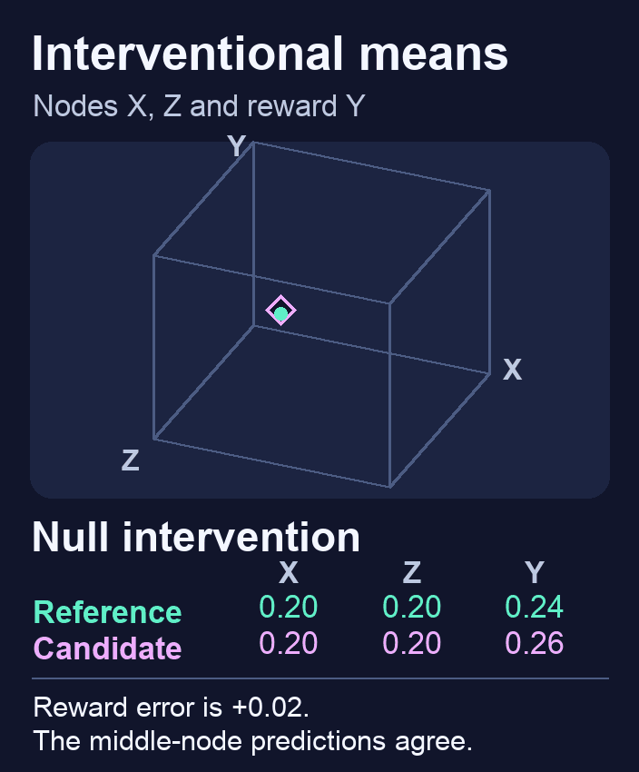

# Gap-free regret for binary linear causal bandits

  

An optimistic algorithm achieves expected regret of order d³√T log(2dT) for an unknown, fully observed binary-linear causal DAG with d binary nodes and a fixed finite menu of hard interventions. The guarantee permits arbitrarily small nonzero weights. The algorithm enumerates discretized DAG models and intervention choices, which can take exponential time.

[Read the paper](paper/manuscript.pdf) · [LaTeX source](paper/manuscript.tex) · [Proof outline](proof/PROBLEM_AND_PROOF.md) · [Run the replay](REPRODUCIBILITY.md)

## What the whole outcome vector reveals

Under the null action the two models agree on the means of X and Z. Setting X to one exposes a disagreement of 0.40 on Z and 0.14 on reward. The learner sees sampled node values and accumulates squared prediction loss across the entire vector.

[Download the offline explorer](https://raw.githubusercontent.com/DannyExperiments/gap-free-binary-linear-causal-bandits/refs/tags/v1.0.0/visualization/mean-predictions-explorer.zip), extract it, and open index.html. Choose an intervention and rotate the mean cube. [Figure guide](visualization/README.md)

## Sources and verification

Feng, Xiong and Chen ask for the square-root horizon rate without a positive weight gap immediately after Theorem 9. The paper answers that statistical question for the fully observed model. [Original question, p. 283](https://raw.githubusercontent.com/mlresearch/v260/main/assets/feng25a/feng25a.pdf#page=13) · [Catalog Q441](https://github.com/10m-u/open-problems-catalog/blob/ca8d4d44ba3db527f19f28928c240168f545ecfe/problems/statistics_data_science/experimental-design-causal-inference.md#q441)

For menus consisting of the null and both assignments of each single node, the paper gives a separate minimax comparison of order min(T, √(mT)) for m ≥ 2. This adapts the hard family and KL method of Lattimore, Lattimore and Reid to cumulative regret. [Causal Bandits, Theorem 2 and proof](https://arxiv.org/pdf/1606.03203#page=11)

[Mathematical audit](audits/public_safe_reports/MATHEMATICAL_AUDIT.md) · [Literature audit](audits/public_safe_reports/LITERATURE_AUDIT.md) · [Scope](CLAIM_SCOPE_AND_LIMITATIONS.md) · [AI disclosure](AI_DISCLOSURE.md) · [Status](STATUS.md)

[Release v1.0.0](https://github.com/DannyExperiments/gap-free-binary-linear-causal-bandits/releases/tag/v1.0.0) · [Version DOI](https://doi.org/10.5281/zenodo.24571499) · [Citation](CITATION.cff)
